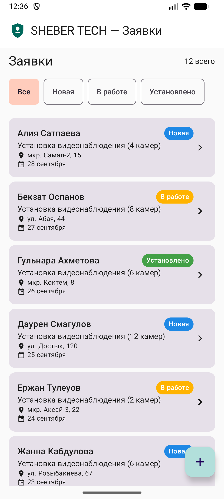
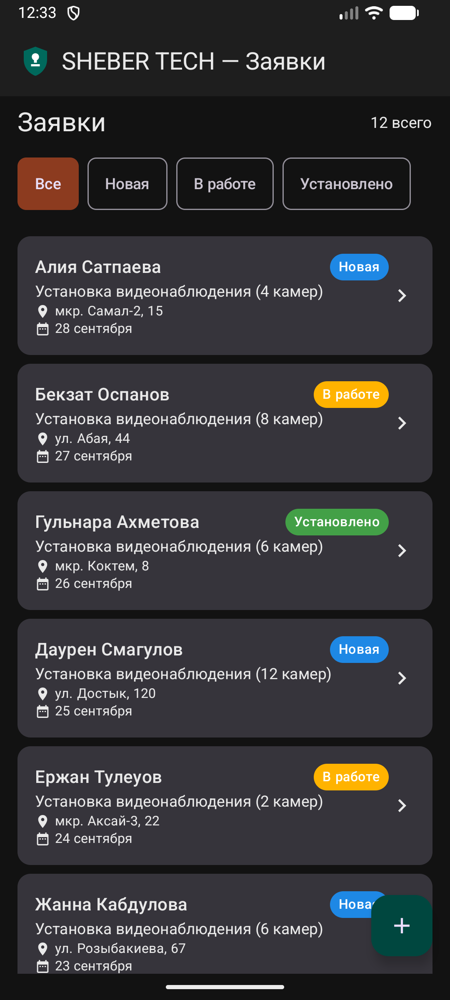
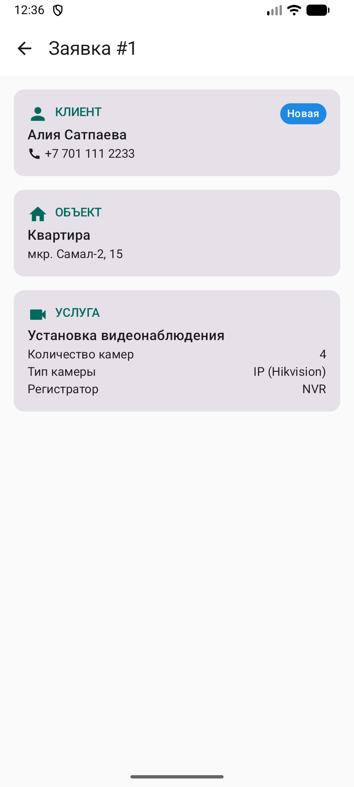
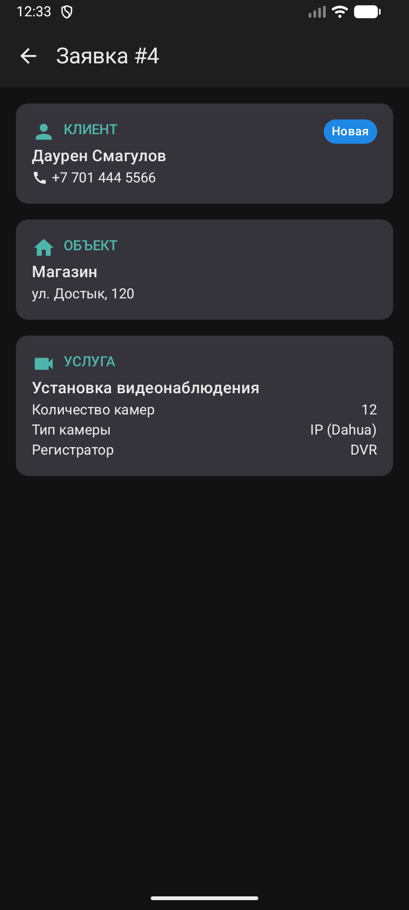
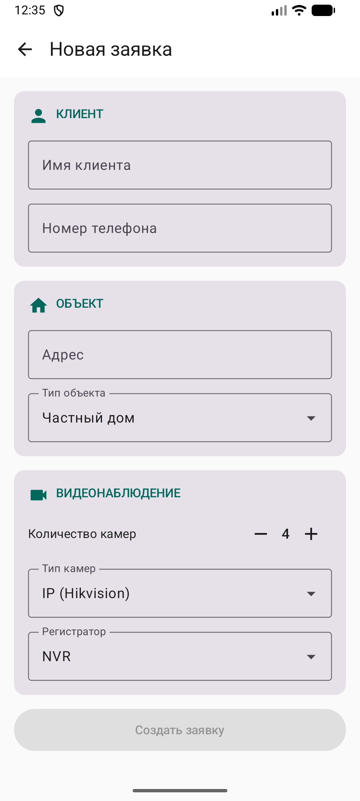
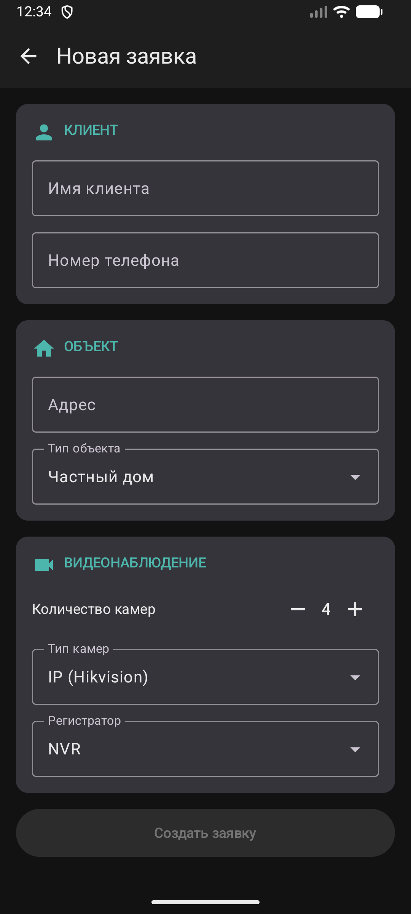

# SheberCRM

Android-приложение (Kotlin + Jetpack Compose) для учёта заявок на установку видеонаблюдения компании SHEBER TECH. Позволяет просматривать заявки, фильтровать их по статусу, открывать детали и добавлять новые.

## Функциональность

1. Просмотр списка заявок (LazyColumn, 12 тестовых заявок)
2. Фильтр по статусу: Все / Новые / В работе / Установлено (LazyRow с чипами)
3. Экран деталей заявки (получает `id` через Navigation Compose)
4. Добавление новой заявки: клиент, адрес, тип объекта, количество и тип камер, регистратор
5. Новая заявка сразу появляется в списке
6. Пустое состояние, если по фильтру заявок нет
7. Светлая и тёмная тема (переключается по системной)

## Скриншоты

| Экран | Светлая тема | Тёмная тема |
|---|---|---|
| Список заявок |  |  |
| Детали заявки |  |  |
| Новая заявка |  |  |

## Эскиз и итоговое приложение

Эскиз лежит в [`design/sheberCRM.png`](design/sheberCRM.png) (сгенерирован с помощью ИИ, подробнее в `AI_USAGE.md`). На нём подписаны блоки Compose: Scaffold, TopAppBar, Column, Row, Box, LazyRow, LazyColumn, Card, Image, Text.

Что совпадает с эскизом:
- структура трёх экранов: список, детали, форма добавления
- шапка с логотипом, строка чипов-фильтров, карточки заявок с цветным бейджем статуса, адресом и датой
- на деталях и в форме карточки-секции с иконками (клиент, объект, услуга)
- в форме выпадающие списки и счётчик количества камер

Что отличается:
- нет галереи «Фото объекта» и блока «История» (вне объёма задания)
- нет иконки поиска и меню «⋮» в шапке
- на экране деталей нет кнопок «Изменить» и «Сохранить» и поля стоимости
- в форме нет поля комментария
- заголовок «Заявка #id» показывает внутренний номер из тестовых данных

## Структура проекта

```
sheberCRM/
├── design/
│   └── sheberCRM.png
├── screenshots/
├── app/
│   ├── build.gradle.kts
│   └── src/main/
│       ├── AndroidManifest.xml
│       ├── res/
│       │   ├── drawable/ic_shield_logo.xml
│       │   └── values/
│       └── java/com/masterfixx/shebercrm/
│           ├── MainActivity.kt
│           ├── model/
│           │   └── Lead.kt
│           └── ui/
│               ├── components/
│               │   ├── EmptyState.kt
│               │   ├── LeadCard.kt
│               │   ├── SectionHeader.kt
│               │   └── StatusChip.kt
│               ├── navigation/
│               │   └── SheberNavHost.kt
│               ├── screens/
│               │   ├── AddLeadScreen.kt
│               │   ├── LeadDetailScreen.kt
│               │   └── LeadListScreen.kt
│               └── theme/
│                   ├── Color.kt
│                   ├── Spacing.kt
│                   ├── Theme.kt
│                   └── Type.kt
├── build.gradle.kts
├── settings.gradle.kts
├── AI_USAGE.md
└── README.md
```

## Сборка и запуск

1. Открыть проект в Android Studio (File → Open → папка `sheberCRM`)
2. Дождаться синхронизации Gradle
3. Запустить эмулятор или подключить телефон
4. Нажать Run ▶ (Ctrl+R на Mac)

Данные хранятся только в памяти и сбрасываются при перезапуске приложения.
